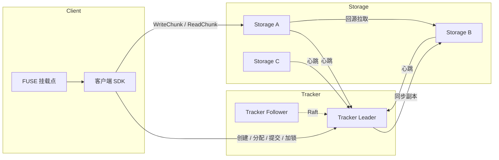

# Criceta

[](https://github.com/JustACP/criceta/actions/workflows/ci.yml)
[](https://pkg.go.dev/github.com/JustACP/criceta)
[](go.mod)
[](LICENSE)

Criceta 是一个用 Go 实现的分布式文件系统：Tracker 负责元数据与调度，Storage 负责
Chunk 的持久化与副本，Client 通过 FUSE 把整个集群挂载成本地目录。

它的目标是在保持实现可读的前提下，覆盖分布式存储的几个核心问题：元数据与数据分离、
大文件切块、覆盖写的版本管理、副本同步、节点故障与租约回收。

## 核心特性

- **元数据 / 数据分离**：Tracker 只保存文件与 Chunk 的映射，数据面读写直接发生在
  Client 与 Storage 之间，避免元数据服务成为吞吐瓶颈。
- **Chunk + Slice 两级组织**：文件按 64 MiB 切分为 Chunk，Chunk 内部的每次写入追加一个
  带版本号的 Slice。覆盖写不必重写整个 Chunk，后台 `Compact` 负责合并重叠 Slice。
- **拉模式副本同步**：主副本提交后，Tracker 只把 `源节点 + 版本 + CRC` 下发给目标节点，
  由目标节点回源拉取整块数据。副本内容与 CRC 都会校验，失败会回写副本状态。
- **基于租约的文件锁**：写租约默认 30s 过期，客户端正常关闭文件时显式释放。客户端崩溃
  不会让文件永久锁死。
- **单机 / 集群两种形态**：`standalone` 模式不需要任何协调服务即可运行；`cluster` 模式下
  Tracker 具备 Raft 选举与 Leader 心跳。

## 架构



| 组件 | 职责 | 入口 |
| --- | --- | --- |
| Tracker | 文件与 Chunk 元数据、节点注册与心跳、副本调度、写租约 | [`cmd/tracker`](cmd/tracker) |
| Storage | Chunk / Slice 落盘、读取、副本拉取与校验、压缩 | [`cmd/storage`](cmd/storage) |
| Client | FUSE 文件系统、写缓冲、按区间读写 Chunk | [`cmd/client`](cmd/client) |

更完整的设计说明见 [docs/architecture.md](docs/architecture.md)。

## 数据模型

```
File ──┬─ Chunk #0  [offset 0,    size 4 MiB)  ──┬─ Slice v1 (offset 0, len 4 MiB)
       ├─ Chunk #1  [offset 4 MiB, size 4 MiB)  ──┴─ Slice v2 (offset 0, len 4 MiB)  ← 覆盖写
       └─ ...
```

- **Chunk** 是副本与校验的最小单位，单个 Chunk 上限 64 MiB；
- **Slice** 是写入的最小单位，每次写入都会生成新的 Slice 并递增版本号；
- 读取时按 Slice 的区间与版本做映射，高版本覆盖低版本，空洞补零。

## 快速开始

前置条件：Linux 或 macOS、Go ≥ 1.23、`make`；客户端还需要 FUSE 3（`fusermount3`）。

RPC 代码由 `idl/` 生成，**不纳入版本控制**，克隆后先生成再编译：

```bash
git clone https://github.com/JustACP/criceta.git
cd criceta
make generate      # 安装固定版本的 kitex/thriftgo 并生成 kitex_gen/
go build ./...
```

启动一个最小集群：

```bash
# 1. Tracker
go run ./cmd/tracker -config configs/tracker.yaml

# 2. Storage（多副本就再复制一份配置，改端口与数据目录）
go run ./cmd/storage -config configs/storage.yaml

# 3. Client 挂载
mkdir -p /tmp/criceta
go run ./cmd/client -mount /tmp/criceta -tracker 127.0.0.1:8888
```

挂载后即可像本地目录一样使用：

```bash
cp ./some-file.bin /tmp/criceta/
cat /tmp/criceta/some-file.bin
```

配置项说明见 [docs/configuration.md](docs/configuration.md)。

## 测试

```bash
make test                              # go test ./...
make test-race                         # go test -race ./pkg/...
make e2e                               # 端到端：1 Tracker + 3 Storage
```

端到端测试会真实编译并拉起进程，验证写入、副本一致性、跨客户端重写等链路。
详见 [docs/testing.md](docs/testing.md)。

## 项目结构

```
cmd/                 三个可执行程序：tracker / storage / client
idl/                 Thrift IDL（Kitex RPC 接口定义）
kitex_gen/           由 IDL 生成的 RPC 代码（`make generate` 生成，不纳入版本控制）
pkg/
  chunk/             Chunk / Slice 的二进制布局、读写、映射与压缩
  config/            配置模型与加载
  meta/              文件 / Chunk / 节点元数据模型与主机指标
  node/
    tracker/         Tracker 服务、Raft 状态、心跳记录、租约
    storage/         Storage 服务、心跳上报、压缩工作池
    client/          客户端 SDK：写缓冲、区间读、Storage 连接池
  client/            FUSE 文件系统实现
  common/            日志、ID 生成、工具函数
test/e2e/            端到端测试（`-tags=e2e`）
docs/                架构、配置、开发与测试文档
```

## 文档

- [架构设计](docs/architecture.md)
- [配置参考](docs/configuration.md)
- [开发指南](docs/development.md)
- [测试指南](docs/testing.md)
- [路线图](docs/roadmap.md)

## 当前状态

核心读写链路已经可用，并通过端到端测试验证：

- 文件创建、写入、读取、删除；
- Chunk 切分与覆盖写（Slice 版本化）；
- 读路径按版本仲裁，主副本故障时自动切换副本；
- 拉模式副本同步与 CRC 校验；
- Storage 变更上报（本地日志 + ACK 裁剪）与周期库存对账；
- 写租约与过期回收；
- Storage 重启后从磁盘恢复 Chunk；
- Tracker 重启后从 `tracker_state.json` 恢复文件与 Chunk 元数据。

仍在路线图中的能力：Raft 日志复制与元数据状态机、孤儿 Chunk TTL 回收、后台副本修复、
容量配额、统一错误码与指标。详见 [docs/roadmap.md](docs/roadmap.md)。

## 许可证

[GNU General Public License v3.0](LICENSE)
