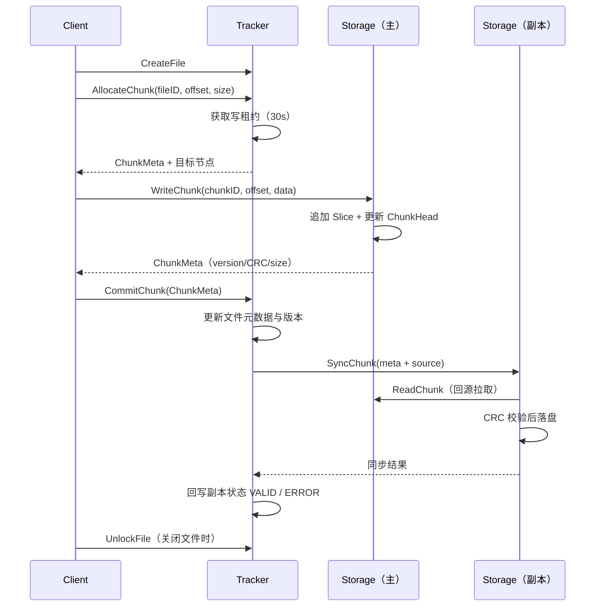
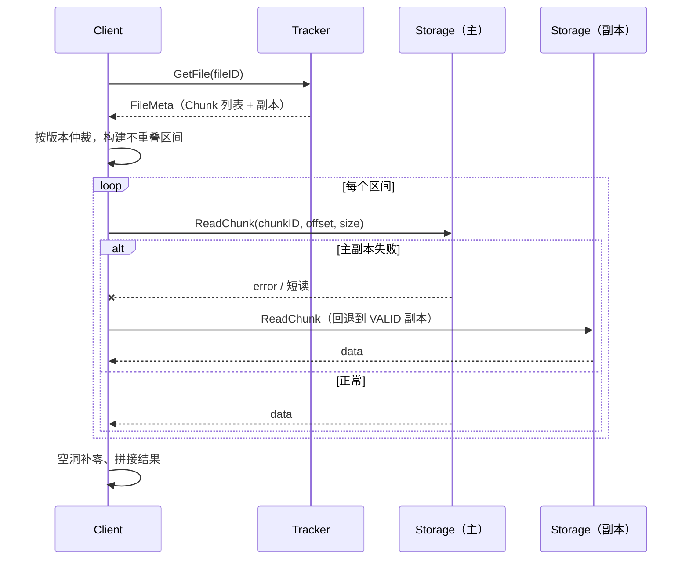
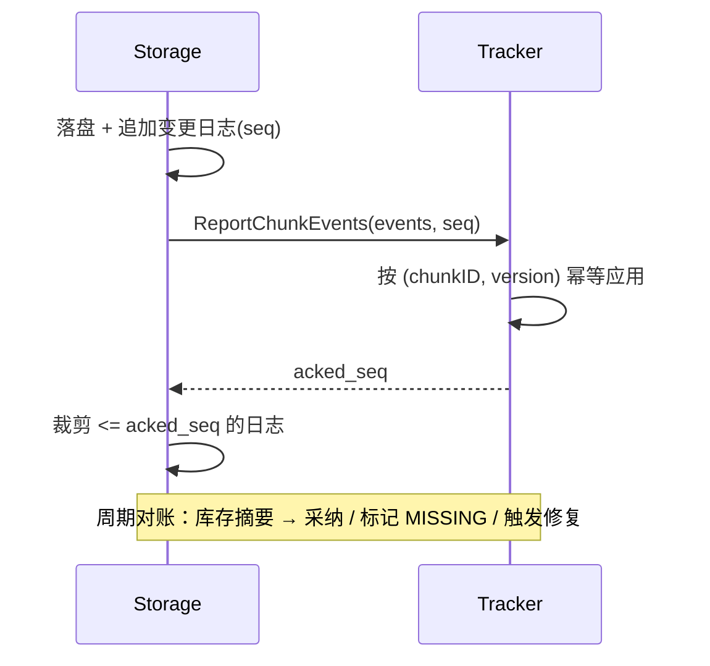

# 架构设计

本文描述 Criceta 的整体结构、核心流程与一致性模型。实现细节以代码为准，文档与代码不一致时
请优先阅读 `pkg/` 下的对应包。

## 1. 设计目标

1. **元数据与数据面分离**：Tracker 只处理小体量的元数据，文件数据由客户端直接与 Storage
   交换，避免所有流量穿过元数据服务。
2. **覆盖写不放大**：大文件按 Chunk 切分，Chunk 内部用追加 Slice + 版本号表达覆盖写，避免
   “改一个字节重写 64 MiB”。
3. **故障可恢复**：节点心跳超时会摘除节点；写租约超时会自动释放；Storage 重启后能从磁盘
   恢复 Chunk 索引。
4. **实现可读**：不引入重量级框架，RPC 使用 Kitex + Thrift，存储格式自定义且带 magic 校验。

## 2. 组件

### Tracker

- 维护 `fileID → FileMeta`、`nodeID → NodeInfo` 两张内存表；
- 分配 Chunk 时选择在线 Storage 节点，并记录文件写租约；
- 客户端提交 Chunk 后更新文件版本，并异步触发副本同步；
- 通过心跳感知 Storage 节点存活，超时（默认 30s）摘除；
- 元数据变更后异步写入 `<data_dir>/tracker_state.json`（临时文件 + fsync + rename），
  启动时自动恢复；
- `cluster` 模式下参与 Raft 选举，`standalone` 模式不启动选举。

### Storage

- 管理本机的 Chunk 集合：`chunkID → SliceBasedChunk`；
- Chunk 元数据（`ChunkHead`，定长 256 字节）与 Slice 数据分别落盘；
- 支持推送 / 拉取两种副本同步方式，写入前做 CRC 校验；
- 后台扫描 Slice 数量过多的 Chunk，交给压缩工作池合并。

### Client

- 实现 FUSE 接口（`Getattr` / `Lookup` / `Create` / `Read` / `Write` / `Flush` / `Release` 等）；
- 维护 4 MiB 写缓冲，按连续区间合并写请求；
- 读文件时把 Chunk 列表转换成区间映射，逐段向对应 Storage 读取，空洞补零。

## 3. 数据模型

```
File
 └── Chunk      （副本与校验单位，上限 64 MiB）
      └── Slice （写入单位，带版本号）
```

`ChunkHead` 使用固定长度二进制编码（magic + 字段），便于原地更新：

| 字段 | 说明 |
| --- | --- |
| `Id` / `FileId` | Chunk 与所属文件 |
| `Version` | Chunk 版本，随写入递增 |
| `Offset` | Chunk 在文件中的起始偏移 |
| `Size` / `Range` | 有效数据长度与区间 |
| `CRC` / `Hash` | CRC32 与 BLAKE3 摘要 |
| `WriteIdx` / `ReadIdx` | 顺序读写游标 |
| `Status` | `VALID` / `WRITING` / `SYNCING` 等 |

每个 Slice 也有自己的头部（magic + 区间 + 版本 + CRC），数据紧跟头部之后。

## 4. 写流程



要点：

- 写租约在 `AllocateChunk` 时获取、`CommitChunk` 时续期、`UnlockFile` 时释放；
  过期后由 Tracker 的后台协程回收。
- 副本同步是异步的：`CommitChunk` 返回不代表副本已经就绪，客户端可以通过 `GetFile` 查看
  `chunk_replicas` 的 `status`。

## 5. 读流程



区间仲裁规则：同一个区间有多个版本时版本号大的覆盖小的（按版本从高到低依次认领），
因此覆盖写之后读到的永远是最新数据。读取时按「主副本 → 其它 `VALID` 副本」的顺序尝试，
单个副本不可用不会导致读失败；返回长度与请求不一致也会触发回退。

## 6. 副本与一致性

- **副本数**：`minReplicaCount = 2`，由 Tracker 在 `CommitChunk` 时按在线节点选择；
- **同步方式**：拉模式。Tracker 只下发元数据与源地址，目标节点主动回源，避免 Tracker 成为
  数据转发瓶颈；
- **校验**：副本写入前校验 CRC32，失败时拒绝覆盖并回写 `ERROR` 状态；
- **一致性**：单个 Chunk 内以 Slice 版本号决定新旧，高版本覆盖低版本；跨 Chunk 的并发写由
  文件写租约串行化。

## 7. 磁盘布局

Storage 节点在配置的 `chunk_storage.file_path` 下维护两个目录：

```
<file_path>/
  meta/
    chunk_<fileId>_<chunkId>.meta   # ChunkHead（定长 256B）
  chunk/
    slice_<chunkId>_<sliceId>.dat   # SliceHeader + 数据
```

- 启动时扫描 `meta/*.meta`，逐个恢复 Chunk 并挂载其 Slice；
- 单个 Chunk 的元数据使用 `O_EXCL` 创建，已存在的 Chunk 不会被截断；
- 读取时按 Slice 的 `offset` 与 `version` 重建区间映射。

## 8. 故障处理

| 故障 | 处理方式 |
| --- | --- |
| Storage 心跳超时 | Tracker 标记离线并移出节点表；新 Chunk 不再分配给它 |
| 客户端崩溃 | 写租约 30s 后自动过期，其他客户端可以接管文件 |
| 副本同步失败 | 记录 `ERROR` 状态并输出日志；当前不会自动重试 |
| 副本 CRC 不匹配 | 拒绝写入，保留本地已有副本 |
| Storage 重启 | 从 `meta/` 恢复 Chunk 索引与 Slice 映射 |
| Tracker 重启 | 从 `<data_dir>/tracker_state.json` 恢复文件、Chunk 与副本状态；节点心跳与写租约重新建立 |

## 9. Storage → Tracker 状态收敛

Storage 先落盘、再把结果告诉 Tracker。如果进程在两步之间中断（客户端崩溃、网络抖动、
Tracker 重启），两边就会不一致：

| 类型 | 表现 | 后果 |
| --- | --- | --- |
| A. 孤儿 Chunk | Storage 有数据，Tracker 不知道 | 数据读不到，且长期占用空间 |
| B. 悬空引用 | Tracker 有映射，Storage 没有数据 | 读到该 Chunk 时失败 |
| C. 副本状态过期 | 副本已同步，但状态回写丢失 | Tracker 一直显示 `SYNCING` |

**原则**：Storage 是自己「持有什么」的权威，Tracker 是「文件 → Chunk」映射的权威。
任何一方都不能单方面推断对方的状态，只能通过可重放的报告收敛。

**协议**

1. **变更日志 + 至少一次上报**：Storage 每次本地变更（写入 / 副本落盘 / 删除）在数据
   `fsync` 之后追加一条 `{seq, chunkID, fileID, version, size, crc, op}` 到本地日志，
   然后调用 Tracker 的 `ReportChunkEvents(events, seq)`。
2. **按节点顺序、幂等应用**：Tracker 为每个 Storage 节点记录 `last_seq`，只接受更大的
   `seq`；事件按 `(chunkID, version)` 去重，版本号不更大的一律忽略，避免旧报告覆盖新状态。
3. **ACK 后裁剪**：Tracker 返回已确认的 `acked_seq`，Storage 才能删除对应日志；失败时
   退避重试，重启后先重发未确认事件。
4. **启动 & 周期对账**：Storage 启动时以及每隔一段时间（如 5 分钟）上报库存摘要
   （chunkID / version / CRC 的列表）。Tracker 用它：
   - 发现未知 Chunk → 若文件仍存在则采纳（补映射并重算文件大小），否则进入孤儿隔离区；
   - 发现映射中的 Chunk 在所有副本上都不存在 → 标记 `MISSING`，触发修复或从可读集合剔除；
   - 发现副本版本低于记录 → 标记副本过期，交给后台重新同步。
5. **孤儿回收**：孤儿 Chunk 超过 TTL 后由 Tracker 下发删除指令（标记 → 确认 → 删除），
   避免误删尚未提交但仍在重试的写入。



## 10. 已知限制

1. 元数据快照只在本机，尚未接入 Raft 日志复制，多 Tracker 之间仍可能不一致；
2. Storage 变更上报与库存对账尚未实现（协议见上一节）；
3. 没有容量配额与孤儿 Chunk GC；
4. RPC 错误多以 Go `error` 返回，错误码体系尚未统一；
5. 客户端与服务端之间没有 TLS / 鉴权。
